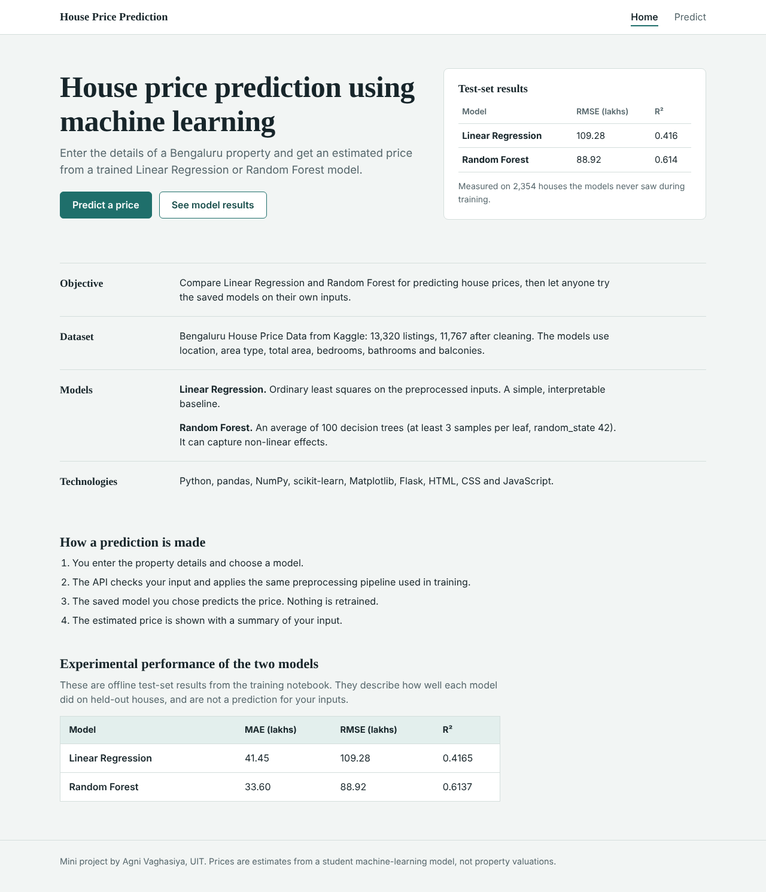
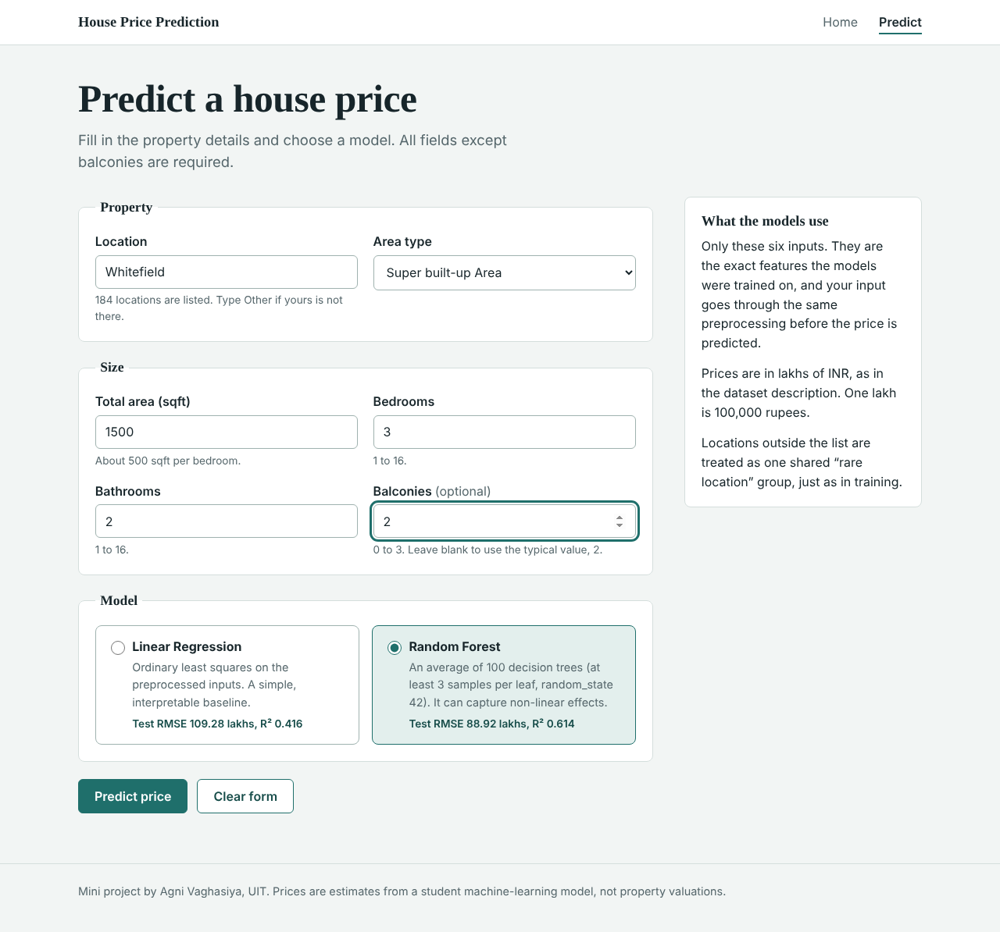
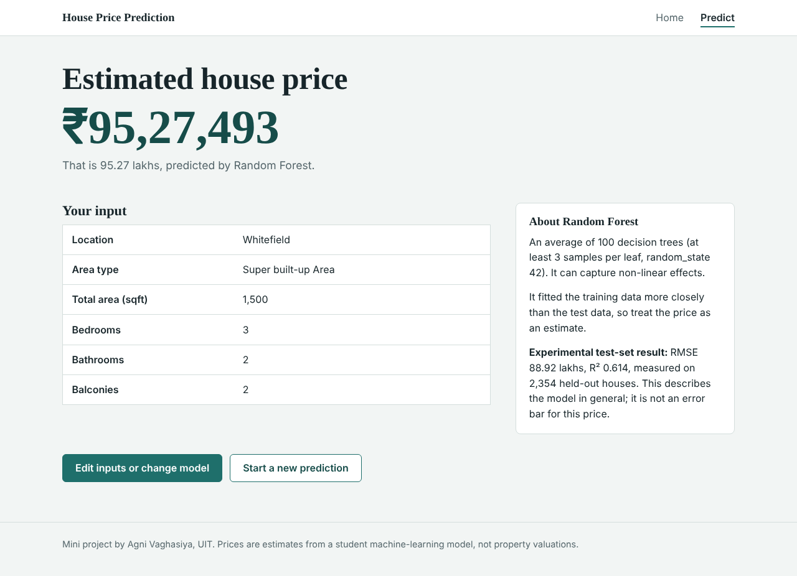
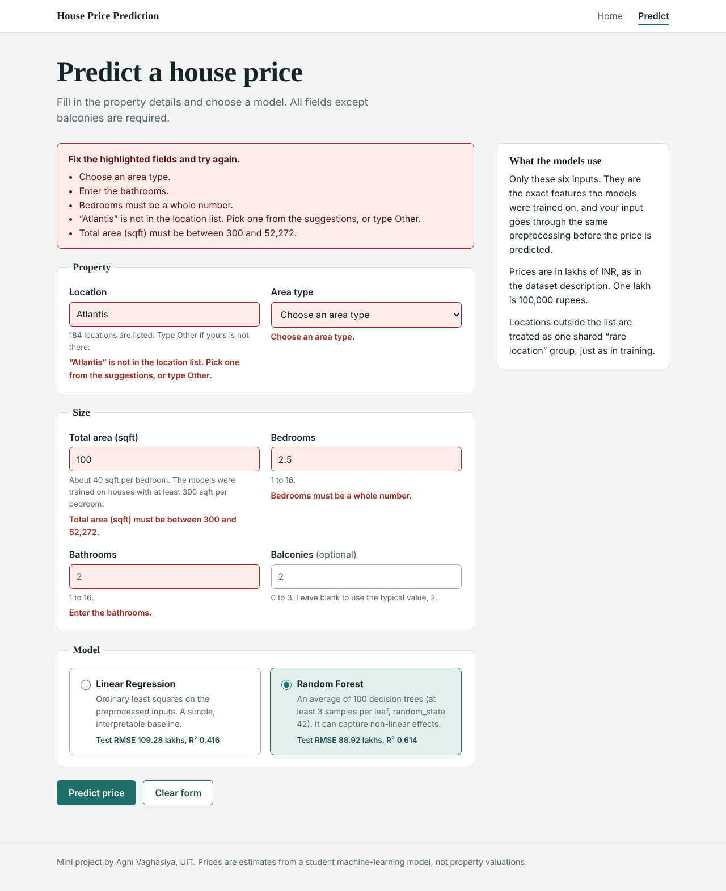

# House Price Prediction Using Machine Learning

**Comparative Analysis of Linear Regression and Random Forest for House Price Prediction**

A mini project that trains two regression models on Bengaluru house listings, compares them on the same held-out test set, and serves both through a small Flask web app.

**Live demo:** _add the Vercel link here after deploying_

## 1. Project overview

The project covers four phases: model development and training, a research paper, a web application, and live testing of the saved models through that application. The web app loads the saved preprocessing pipeline and models; it never retrains.

## 2. Problem statement

Given the listed attributes of a Bengaluru property (location, area type, total area, bedrooms, bathrooms and balconies), predict its listing price in lakhs of Indian rupees, and decide which of Linear Regression and Random Forest predicts more accurately on unseen houses.

## 3. Objectives

1. Build a reproducible preprocessing pipeline that avoids data leakage.
2. Train a Linear Regression model and a Random Forest regressor.
3. Evaluate both with MAE, MSE, RMSE and R² on the same held-out test set.
4. Identify the better model and explain the difference.
5. Save the models and pipeline, and use them in a web application without retraining.

## 4. Dataset

| Item | Detail |
|---|---|
| Name | Bengaluru House Price Data |
| Source | Kaggle: https://www.kaggle.com/datasets/amitabhajoy/bengaluru-house-price-data |
| Size | 13,320 rows and 9 columns (11,767 rows after cleaning) |
| Target | `price`, in lakhs of INR (per the dataset description; confirm on the Kaggle page) |
| Features used | `location`, `area_type`, `total_sqft`, `bhk` (parsed from `size`), `bath`, `balcony` |
| Dropped | `society` (41.31% missing), `availability` |
| Licence | Check the Kaggle page. The CSV is **not** stored in this repository. |

To run the notebook, download `Bengaluru_House_Data.csv` from Kaggle and place it in `data/`. Details are in [`data/dataset_link.md`](data/dataset_link.md).

## 5. Technologies

Python (tested on 3.12), pandas, NumPy, scikit-learn, Matplotlib, Seaborn, joblib, Flask, HTML, CSS and JavaScript.

## 6. Methodology

1. Load and verify the data.
2. Clean it row by row: remove duplicates, rows missing location, size or bath, rows with area in unsupported units, rows under 300 sqft per bedroom, and rows with more than two extra bathrooms (13,320 to 11,767 rows).
3. Split 80/20 with `random_state=42` (9,413 training rows, 2,354 test rows).
4. Explore the training data only.
5. Fit one preprocessing pipeline on the training data only: median imputation and scaling for numbers, one-hot encoding for categories, with locations seen 10 times or fewer grouped together.
6. Train both models on the same transformed data and evaluate them once on the test set, plus 5-fold cross-validation on the training data.

## 7. ML models

| Model | Setup |
|---|---|
| Linear Regression | Ordinary least squares on the 193 preprocessed columns |
| Random Forest | 100 trees, `min_samples_leaf=3`, `random_state=42`, other settings default |

The hyperparameters were fixed in advance and were not tuned on the test set.

## 8. Evaluation metrics

MAE, MSE, RMSE and R². Errors are in lakhs of rupees (MSE in lakhs squared).

## 9. Experimental results

Test set (2,354 houses):

| Model | MAE | MSE | RMSE | R² |
|---|---|---|---|---|
| Linear Regression | 41.45 | 11,942.94 | 109.28 | 0.4165 |
| Random Forest | 33.60 | 7,906.31 | 88.92 | 0.6137 |

Random Forest is better on all four metrics (RMSE 18.6% lower). Other findings from the notebook:

- 5-fold cross-validation agrees: R² 0.617 for Random Forest against 0.371 for Linear Regression.
- Random Forest over-fits to some degree: R² 0.821 on training data, 0.614 on test data.
- Linear Regression predicted a negative price for 55 of the 2,354 test houses.
- Total area carries 77.1% of the Random Forest feature importance.

All numbers come from [`notebooks/house_price_prediction.ipynb`](notebooks/house_price_prediction.ipynb). Tables and graphs are in [`results/`](results/).

## 10. Web application

The app has two parts: static pages in `public/` and a Flask API in `api/index.py`. The pages send the form to the API, which loads the saved preprocessing pipeline and models. It never retrains.

- **Home page:** project description, objective, technologies and the two models, with the offline test-set results labelled as such.
- **Prediction page:** a form with exactly the six features the models use and a model selector. Balconies is optional, and a blank value uses the training median (2).
- **Result page:** estimated price, input summary, the selected model and its test-set performance.
- **Validation:** friendly messages for missing, non-numeric, out-of-range and unknown values. Linear Regression can return a negative price for some small flats, and the app explains this instead of showing it.
- **API:** `GET /api/options` lists the form options and the offline test results. `POST /api/predict` validates the input and returns the price as JSON.
- **Testing:** 31 requests sent to the running API, 31 passed, plus checks on the pages. See [`results/web_app_tests.md`](results/web_app_tests.md).

Example request:

```bash
curl -X POST http://127.0.0.1:5000/api/predict -H "Content-Type: application/json" \
  -d '{"location":"Whitefield","area_type":"Super built-up Area","total_sqft":1500,"bhk":3,"bath":2,"balcony":2,"model":"random_forest"}'
```

## 11. Installation

```bash
git clone https://github.com/<your-username>/house-price-prediction.git
cd house-price-prediction
python -m venv .venv
.venv\Scripts\activate            # Windows. On macOS/Linux: source .venv/bin/activate
pip install -r requirements-notebook.txt
```

`requirements.txt` has only what the web app needs. The pinned versions match the ones that created the saved models, because saved scikit-learn models load reliably only with the same version.

## 12. How to train the models

1. Put `Bengaluru_House_Data.csv` in `data/`.
2. Open `notebooks/house_price_prediction.ipynb` and choose **Run All**.
3. The last cells write `models/preprocessor.pkl`, `models/linear_regression.pkl`, `models/random_forest.pkl` and the files in `results/`.

The repository already contains these files, so you only need to retrain if you want to reproduce them.

## 13. How to run the web application

From the project root:

```bash
pip install -r requirements.txt
python dev_server.py
```

Open http://127.0.0.1:5000. To check the saved model files first, run `python export_model.py`. To run the 31 tests, start the app and, in a second terminal, run `python tests/run_tests.py`.

## 14. Sample screenshots

| Home | Prediction form |
|---|---|
|  |  |

| Result | Validation errors |
|---|---|
|  |  |

## 15. Project structure

```
house-price-prediction/
├── api/
│   └── index.py                Flask API (also the Vercel entry point)
├── public/                     static pages
│   ├── index.html
│   ├── predict.html
│   ├── result.html
│   ├── style.css
│   └── app.js
├── dev_server.py               run pages + API locally
├── export_model.py             checks / re-saves the model files
├── pyproject.toml              project settings and Vercel entry point
├── vercel.json                 Vercel function settings
├── requirements.txt            web app packages (pinned)
├── requirements-notebook.txt   notebook packages
├── .python-version
├── data/
│   └── dataset_link.md         where to get the dataset
├── notebooks/
│   └── house_price_prediction.ipynb
├── models/
│   ├── preprocessor.pkl
│   ├── linear_regression.pkl
│   └── random_forest.pkl
├── tests/
│   └── run_tests.py            sends test requests to the running app
├── results/
│   ├── comparison.csv
│   ├── model_metrics.txt
│   ├── test_predictions.csv
│   ├── web_app_tests.md
│   ├── figures/
│   └── screenshots/
├── research-paper/
│   └── IEEE_Research_Paper.docx
└── presentation/
    └── Research_Presentation.pptx
```

## 16. Research paper

[`research-paper/IEEE_Research_Paper.docx`](research-paper/IEEE_Research_Paper.docx) is an IEEE-style draft built from the real results in this repository. Its literature review, state of the art, research gap and most references are still to be completed.

## 17. Presentation

[`presentation/Research_Presentation.pptx`](presentation/Research_Presentation.pptx) follows the course presentation template. The state-of-the-art slide and the date and division fields are still to be completed.

## 18. Team

- Agni Vaghasiya, Unitedworld Institute of Technology (UIT), Karnavati University, Gandhinagar

## 19. Limitations

- One city, and asking prices rather than final sale prices.
- No parking, property age or number of floors in the dataset.
- The cleaning rules (for example 300 sqft per bedroom) are judgement calls, and a few extreme area values remain.
- Hyperparameters were fixed, not tuned, and Random Forest over-fits the training data to some degree.
- Linear Regression can give extreme or negative prices for unusual inputs, and the two models can disagree a lot on the same property.
- The price unit (lakhs of INR) and the dataset licence still need to be confirmed on the Kaggle page.

## 20. Future scope

- Try a log-price target and tune the hyperparameters with cross-validation.
- Compare other models, such as gradient boosting.
- Add features (parking, age, floors) and data from other cities and periods.
- Add a way to explain each prediction.

## Deployment (Vercel)

1. Push this repository to GitHub (the folders must keep their structure: `api/`, `public/`, `models/` and so on).
2. On https://vercel.com/new, import the repository. Vercel detects Flask from `requirements.txt` and uses `api/index.py` (set in `pyproject.toml`).
3. Keep the default settings and deploy. `vercel.json` makes sure the models and pages are bundled and the documents are left out.
4. Add the live link at the top of this README.

If the build fails with a size error, the bundle exceeded Vercel's Python function limit; remove anything not needed at runtime from `requirements.txt`.
